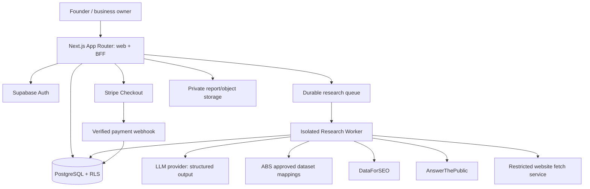

# NextSignal — Architecture Specification

> Version: 0.1.0 (2026-10-26)  
> Status: Architecture direction and local M1 scope approved by owner on 2026-10-27; production review remains open
> Product: Australia-first founder market research and business growth intelligence  
> Design status: Next Signal naming confirmed; application of root `DESIGN.md` and bilingual UI approved on 2026-10-28. UI library selection remains deferred; see ADRs 0004–0005.

## 1. Product mission and bounds

**Positioning:** *Know Your Business. Validate your idea. Grow with evidence.*

Two independent entry points share one evidence engine:

1. **Validate My Idea** — natural-language idea → founder-confirmed business hypotheses → Australian demand evidence, customer questions, competitors, counter-evidence, experiments.
2. **Grow My Business** — website URL → safely extracted site facts → founder-confirmed business profile → foundational SEO checks, demand/competitive evidence, prioritised actions.

**Initial geography:** Australia. Market parameters include nation, state/territory, and optional city. Do not falsely claim city-level precision for data aggregated at larger geographies.

**MVP exclusions:** automatic publication to external sites; connecting private CRM/ERP; full GEO ranking guarantees; scraping paywalled sources; unrestricted competitive surveillance; financial projections masquerading as facts; automated investment/legal advice; open-ended agent autonomy; multi-seat enterprise features.

### MVP business success signals
- Rate of completed, source-grounded reports.
- Business-profile correction rate and human quality audit outcomes.
- Percentage of users who return to view results and voluntarily request follow-up.
- Paid report conversion and fully burdened cost per report.
- Evidence coverage and provider failure rate, separately by entry point.

## 2. Domain model

`User` → `Workspace` → `Project` (idea or operating business; **one project can transition stages**) → `BusinessProfileVersion` → `ResearchRun` → `EvidenceRecord`, `KeywordObservation`, `CompetitorRecord`, `Finding`, `ReportVersion`, `ActionItem`, `Experiment`.

Commercial domains: `Entitlement`, `Checkout`, `Payment`, `LeadRequest`. Operational domains: `ApiUsage`, `AuditEvent`, `ProviderLicense`, `DeletionRequest`.

Important invariant: reports are immutable snapshots after publication; later source updates or corrections create a new version, not silent edits.

## 3. System context and deployment



**Recommended implementation:** TypeScript monorepo; Next.js frontend/BFF; PostgreSQL with Supabase Auth and RLS; separate worker deployed with network egress controls; durable queue (a transactional job table + claimed leases is acceptable in MVP; replace with managed queue when justified); Stripe Checkout/Webhooks; encrypted secrets in hosting provider. Deploy web separately from fetch worker.

**Never:** run untrusted URL fetching from a privileged web server that can reach internal networks; put privileged database keys or paid provider credentials in browser bundles; accept raw LLM output as persisted facts.

## 4. Module boundaries

| Module | Owns | Must not own |
|---|---|---|
| `web` | routes, UI, accessible user experience, public SEO pages | paid API secrets, scraping |
| `identity` | authentication, role/tenant authorisation | report business inference |
| `projects` | project state, stage and user-verified profile | raw providers |
| `research-orchestrator` | state machine, provider execution plan, budgets, failure handling | front-end styling |
| `providers/abs` | authorised ABS dataset catalogue, geography/units/time metadata | free-form market-size estimates |
| `providers/dataforseo` | SERP and search metrics, explicit geo/language and cost | defining entrepreneur intent |
| `providers/answerthepublic` | question discovery, usage entitlement | overclaiming measured demand |
| `fetcher` | restricted public URL reading and HTML extraction | reading private websites without authorisation |
| `seo-rules` | deterministic site/HTML checks | invented ranking penalties |
| `evidence` | normalize sources, provenance, licensing, confidence | unsupported speculation |
| `analysis` | profile inference, mapping findings to evidence, red-team hypotheses | numerical fabrication |
| `reporting` | versioned reports, export, tier redaction | direct provider secrets |
| `billing` | idempotent fulfillment, refunds integration, entitlement | report conclusions |
| `telemetry` | anonymized funnels, system observability, API spend | invasive tracking |
| `design-system` | tokens, components, accessible UI | product/business policies |

Communication through typed interfaces and server-side APIs. No circular module imports.

## 5. Canonical pipeline

1. Accept `IDEA` or `WEBSITE` input; validate length, geography, language, ownership assertions (if needed), consent and budgets.
2. Create project/run with immutable input snapshot and `queued` status.
3. Extract business hypothesis/profile. For website input, use **secure public crawler** and deterministic SEO checks.
4. Show founder verification (`confirmed`, `corrected`, `unknown`). Avoid presenting guesses as established company facts.
5. Research planner proposes bounded search intents, keywords, regions and datasets; enforce allowlists and budgets.
6. Providers return evidence, including source, metric definition, units, window, geography, collected time, license and uncertainty.
7. Normalize/deduplicate/cache sources; flag missing, old or contradictory data; independent source-grounded competitor research as licensed/allowed.
8. Generate opportunity and **Red Team** risk findings, each referencing supporting or contradictory evidence IDs.
9. Validate output against JSON schema, evidence references, confidence semantics and safety rules. If validation fails, retry once within cost budget or return partial results.
10. Publish `free_snapshot` or, after verified payment, start separate deeper `paid_research` run. Never incur full paid research costs just to hide its output.
11. Save user correction, action and experimental outcomes to same project; transition `idea → launch → growth` without losing original hypotheses.

Research run statuses: `queued → planning → collecting → analysing → validating → completed|partial|failed|cancelled`; every transition logged and idempotent.

## 6. Evidence contract (mandatory)

```ts
type Evidence = {
  id: string;
  projectId: string;
  provider: 'abs'|'dataforseo'|'answerthepublic'|'first_party_site'|'approved_public_source';
  sourceUrl?: string;
  sourceRef?: string;
  retrievedAt: string;        // ISO-8601
  observedPeriod?: { from?: string; to?: string };
  geography: { country: 'AU'; state?: string; locality?: string; granularity: string };
  metric: string;
  value: number|string|null;
  unit?: string;
  methodology?: string;
  limitations: string[];
  licenseId?: string;
  kind: 'measured'|'estimated'|'reported'|'inferred';
  confidence: 'high'|'medium'|'low'|'insufficient';
};

type Finding = {
  id: string;
  observation: string;
  status: 'supported'|'hypothesis'|'contradicted'|'unknown';
  evidenceIds: string[];
  counterEvidenceIds: string[];
  proposedAction: string;
  validationMethod: string;
};
```

Rules: Google Ads paid competition ≠ organic SEO difficulty; search volume ≠ willingness to pay; ABS macro population ≠ TAM/SAM/SOM; SEO issue ≠ proven lost revenue; AI-generated answer appearances ≠ stable ranking; an old or foreign failure story ≠ Australian market failure forecast.

**No numeric assertion without typed source and metric.** No invented competitors, pricing, search volume, investment, traffic, results or probabilities. If data unavailable, return a clearly labeled unknown. Underlying API provider uncertainty must be propagated through to the report.

## 7. Provider integration rules

- Every adapter has contract tests, circuit breaker/timeout, backoff, quota, cache TTL and feature flags.
- Maintain an **approved-license register** with provider, products/endpoints, permitted outputs (display, summary, export, cache, derivative works), retention, attribution, territories, amendment date and written approval owner.
- **ABS:** maintain curated SDMX datasets with valid dimensions, units and period matching; skip irrelevant census indicators; differentiate ABS Data API from other ABS API products as their authentication and license requirements may differ.
- **DataForSEO:** use AU geo and intended language; make search volume & SERP requests only when necessary; log billable tasks; do not confuse paid CPC metrics with purchase intent.
- **AnswerThePublic:** API entitlement is a deployment precondition for enabled features; if subscription/alpha quota unavailable return partial report, never fake results.
- **Loot Drop:** discovery only until explicit commercial license or lawful permitted use confirmed. Do not mirror, repackage, bulk scrape or train on content without proper rights.
- Never promise the user that one provider supports unlimited queries, syndication or resale before checking written license terms.

## 8. Access control and sensitive data

- Auth roles: `visitor`, `member`, `admin`, optional `support` with separate audited grants.
- PostgreSQL RLS on each tenant-owned table; `workspace_id` and owner checks on every read/write, including exports and async callbacks.
- Reports and raw idea text are **private by default**; `noindex` is not security. No public report links unless explicit user sharing with expiring revocable token.
- Data minimisation, defined retention, deletion workflow including backups and vendor-specific limitations, encryption in transit/at rest.
- Do not train shared models on user ideas, reuse private idea text for another customer, or publish user submissions without affirmative permission.
- Do not submit private ideas to external search providers as raw text when derived nonsensitive terms suffice. Disclose AI subprocessors and cross-border handling.
- Web URL fetch: SSRF protection by dedicated egress-restricted worker; enforce public IP validation at connection and each redirect; block localhost, private/link-local/metadata, non-HTTP(S), ports, oversized responses; anti-DNS-rebinding, content-type restriction, concurrency and request budgets; respect lawful site conditions.
- Defend against HTML prompt injection: treat fetched content as untrusted data, separate system instruction and source materials.
- Admin access uses MFA, scoped access, audit trail and no use of private founder ideas for unsolicited sales.

## 9. Paid product and billing invariants

Launch tiers: `Free Snapshot` and `Paid Evidence Report` (starting A$49 **hypothesis**). Upsell human review manually only after users explicitly request contact. Subscription is deferred until recurrence is proven.

- Free and paid are *distinct workloads*, not a CSS paywall hiding already-generated expensive content.
- Stripe webhook signature verification, deduplication by provider event ID and order ID, transactional entitlement grants.
- Price, GST handling, payment timing, delivery scope, refunds, limitations and report status visible before checkout.
- Provide an honest partial report or appropriate remedy when provider is unavailable; never fabricate missing evidence.
- Ensure Australian Consumer Law rights are not excluded by T&Cs or a blanket 'no refunds' claim.
- Usage caps, per-run cost ceilings and global daily budget shutoff; admins can disable provider or paid generation.

## 10. Public website SEO/GEO standards

- Public marketing pages rendered in crawlable HTML; semantic headings, accessible navigation, canonical URLs, unique descriptive titles and meta descriptions, sensible schema only when applicable, sitemap and robots policies.
- Private workspace, generated founder ideas and user reports excluded from indexing and server-protected.
- Publish original, factual Australia-specific research rather than templated SEO pages at scale.
- No guaranteed Google rankings, AI citation inclusion, inflated 'SEO scores' or fabricated customer reviews.
- Search Console and analytics instrumentation require consent/cookie/privacy implementation appropriate to the deployment and applicable law.

## 11. Nonfunctional requirements (initial targets, not SLAs)

- API request idempotency, per-user/IP throttling, CAPTCHA/risk challenge for anonymous analysis.
- Worker retry with idempotency and max retries; poison queue and operator replay.
- Provider outages yield partial results and preserve evidence already gathered.
- Observability: traces/job ID, provider latency, spend per run, error rate, queue age, evidence count, conversion funnel.
- Monitoring excludes raw idea text, credentials, emails and full fetched website contents by default.
- Automated DB backups and tested restore; test deletion across report, analytics and storage layers.
- Performance: static pages optimised for CWV; reports paginated or progressively loaded.

## 12. Delivery order and release gates

| Gate | Feature | Exit criteria |
|---|---|---|
| G0 | Baseline repo & governance | Engineering rules, CI, secrets, license register, threat model accepted |
| G1 | Project/idea pipeline | Idea text → profile → user correction → persisted run; zero fake evidence |
| G2 | Evidence providers | ABS, DataForSEO, ATP adapters tested with fixtures, failures, cost controls and rights review |
| G3 | Idea report | Source traceability, 3 experiments, red-team review, quality benchmark with 10 examples |
| G4 | Website analysis | Safe URL fetch, deterministic SEO, business reconciliation, 3 evidence-backed actions |
| G5 | Monetisation | Payments, entitlement, reconciliation, ACL refund support, security/PII checks |
| G6 | Public beta | Privacy/commercial legal readiness; abuse load test; analytics; founder feedback and support |

Freeze scope at G6. Defer subscriptions and auto-publishing until confirmed repeat demand.

## 13. Design hand-off protocol

**Do not introduce new colors, fonts, design systems, component libraries or motion patterns.** Root `DESIGN.md` is now the received reference. The functional M1 surface uses native controls and existing tokens only; exact font files, brand naming and library handoff remain pending.

When the owner supplies `design.md` / component library, create an ADR recording choice; translate design tokens to one source of truth; implement UI against business-domain contracts. Visual changes must not bypass privacy notices, permission boundaries, evidence caveats or accessible input validation.

## M1 implementation addendum — 2026-10-27

ADRs 0001–0003 refine this conceptual baseline for the approved local fixture slice. Profile preparation and founder confirmation precede research runs. Claims distinguish authorship from evidence method. M1 uses a dedicated loopback PGlite host and explicit test identities; native PostgreSQL/Supabase Auth, real providers, payments, fetch isolation and production infrastructure are not implemented or approved. See `operations/M1.md` for the implemented subset and remaining release gates.

## 14. Architecture change management

Current local runtime update — 2026-10-28: ADR 0007 replaces the original PGlite host with persistent Docker PostgreSQL. Web/worker use reduced-privilege native pools, database-backed hashed sessions and a checked migration-readiness marker. PGlite is retained for scoped tests and legacy export only. The owner has also confirmed Next Signal and approved DESIGN.md typography/colours and bilingual UI (ADRs 0004–0005); the earlier pending-design statements describe the original baseline. Production identity, providers and deployment remain separate gates.

Every significant decision requires `docs/adr/NNNN-title.md`: context, options, decision, alternatives, security/privacy impact, cost, rollback and owner. Update contract tests and schema migrations with architecture changes. Record source license approvals and legal sign-off separately from technical completion.
