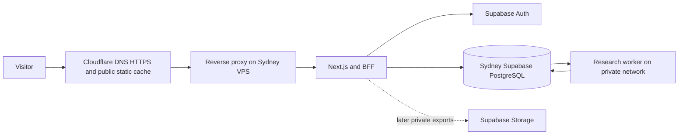

# Next Signal production infrastructure plan

2026-11-07, Australia/Sydney. Repository audit and proposal for owner approval.

## 1. Existing infrastructure and functionality

The Next.js App Router serves the homepage, the M1 idea workspace at `/validate`, the planned growth page at `/grow`, and private report details at `/projects/[projectId]/reports/[reportId]`. The report view loads a project through the BFF and selects the report and its historical profile. Existing English and Simplified Chinese presentation follows `DESIGN.md`.

The catch-all API forwards health, session and project operations to the local worker host. That host handles login, project list/create/get/delete, profile confirmation and run start/cancel. `Projects` and `ResearchRunner` use the repository's SQL transaction interface, `pg` and Zod. There is no ORM, Supabase client dependency, production Dockerfile or production Compose stack. The current Compose files run local and disposable test PostgreSQL. GitHub Actions defines local-style checks and native database tests.

## 2. Data flow and persistence

| Data | Current behavior |
| --- | --- |
| Accounts and sessions | Fixed Alice/Bob test identities. Opaque random session tokens are held in an HttpOnly, SameSite=Strict cookie. SHA-256 digests, identity and expiry are stored in `local_fixture.sessions` for one hour. Logout revokes the session. |
| Projects and confirmed profiles | Persist in Docker PostgreSQL. Refresh clears the selected project and unsaved edits unless a route identifies the project. Reopen a saved project to recover its data. |
| Jobs, evidence, findings and reports | Persist in the same database. The worker generates synthetic results. Report versions are immutable and bind to the profile used for the run. |
| Browser state | The locale preference uses localStorage. Unsaved idea/profile edits and transient UI state live in React memory. |
| Conversations, uploads and files | The repository has no chat history implementation, uploads, exports or object storage integration. |
| Growth and entitlements | Growth is an informational route. Pricing cards describe proposed services. There is no website fetcher, live research provider or billing entitlement. |

The current path is browser → Next BFF → capability-protected loopback HTTP host → `PostgresDatabase.asUser` → transaction-local role and subject → RLS. The local `auth.users` and `auth.uid()` are compatibility shims. PGlite is used for scoped tests and legacy import. Both the BFF and worker entry reject production execution, so a successful Next build does not establish a deployable authenticated backend.

## 3. Proposed production topology

Use `nextsignal.com.au` and explicitly select the Sydney Supabase project region `ap-southeast-2`. Keep the web process and worker in separate containers on the same VPS initially. The Next server can call the existing application use cases through the production repository, leaving the local HTTP bridge as the development path. The worker claims jobs directly from PostgreSQL and needs no public HTTP listener. Put web and worker connections behind separate small `pg` pools. Use verified TLS with a suitable direct connection, or the session pooler if the VPS has only IPv4. Prove role membership and transaction-scoped identity with the chosen endpoint. Regional placement reduces distance between the app and database. Overseas visitors still reach Sydney for uncached work, and provider processing and support access need a separate data-flow review. [Regions](https://supabase.com/docs/guides/platform/regions) · [Connections](https://supabase.com/docs/guides/database/connecting-to-postgres)

## 4. Database entities and rollout

| Entity | Reuse or proposed extension |
| --- | --- |
| Account and workspace | Use Supabase `auth.users.id` as the user UUID. Keep `workspaces.owner_id`. Provision one default workspace idempotently using a narrow server operation and a reviewed uniqueness rule. Add an application profile only when it has product fields to store. |
| Project | Keep `projects.workspace_id` and its ownership chain. Add name, product type and updated timestamp only when the UI uses them. Preserve lifecycle stage separately from product type so the same project can grow into a launched business. |
| Business understanding | Reuse `profile_versions` and confirmed snapshots. New typed fields may include description, target audience, geography, industry and source/update metadata. Keep confirmation provenance. |
| Research and queue | Reuse `research_runs`, `jobs` and `run_events`. A run owns its confirmed profile and execution state. Jobs carry delivery, lease, attempts and scheduling details. |
| Evidence and report | Reuse `evidence_records`, `findings`, `finding_evidence_links`, `action_items` and `report_versions`. Extend the typed payload and SQL checks together when the first real provider is approved. Keep source, retrieval and observation periods, geography, units, limitations and usage provenance. |
| Chat, when shipped | `conversations` belongs to a project and workspace. `messages` stores each message separately with role, content, timestamp and optional usage. Enforce composite ownership keys and index `(conversation_id, created_at, id)` for stable cursor pagination. Keep history separate from bounded model context. |
| Exports, when shipped | `report_files` references the report and tenant and records bucket/path, MIME type, size, creation time and lifecycle status. Keep binaries in object storage. |
| Usage and entitlements, when needed | Extend `provider_calls` for per-operation reservation, estimates, actual costs and tokens. Add aggregate quota counters only where required for atomic enforcement. Defer an entitlement table until access rules exist. |
| Consent, audit and deletion | Reuse `consent_events`, `audit_events` and `deletion_requests`. Extend deletion status only when asynchronous file or account deletion requires it. |

Review indexes for workspace project listing, owner lookup, run/profile history, report version retrieval and queue polling. Start with existing project/report APIs. Split summary listing from single-version payload reads when history size causes measurable query or response costs. Add composite foreign keys to new children so a valid foreign UUID from a different tenant cannot be assigned.

## 5. Supabase Storage

Create `report-exports` as a private bucket when exports ship. Defer `user-uploads` until an approved upload feature needs it. Use generated paths such as `{ownerId}/{projectId}/{reportId}/{fileId}.pdf`, with a corresponding DB row. Before issuing a signed download, the BFF verifies the session and ownership, then asks Storage to enforce a policy against the authorized report and file metadata. Prefer a user-scoped signer with a narrow ownership check. An exporter writes through a separately reviewed server capability. Expiry starts at a proposed five minutes. Treat the URL as a bearer credential and redact it from logs.

Keep re-exports as new objects tied to the same immutable report. Use idempotent pending/ready/deleting states and an orphan sweeper with a grace period and dry-run mode. Delete the object through Storage before marking its deletion complete. If uploads are added, set per-bucket size/MIME limits, check file signatures and extensions server-side, generate object names and quarantine unsupported content. Keep provider-neutral file metadata so a later S3-compatible adapter can be added. [Private buckets](https://supabase.com/docs/guides/storage/buckets/fundamentals) · [Storage access control](https://supabase.com/docs/guides/storage/security/access-control)

## 6. Authentication and RLS

Recommend hosted Supabase Auth for real accounts and the existing local fixture adapter for development. Google first limits the initial callback and account lifecycle work. Add Facebook when audience demand justifies the provider setup and review. A mature self-managed library could be appropriate if vendor independence or unusual identity requirements become decisive. For this app, maintaining provider integration, refresh and revocation, identity linking, account recovery and incident response separately has little product value, and adds work when mapping identity to Supabase PostgreSQL and Storage. [Google setup](https://supabase.com/docs/guides/auth/social-sign-in/auth-google) · [Facebook setup](https://supabase.com/docs/guides/auth/social-sign-in/auth-facebook)

Use Supabase's supported Next SSR client and PKCE flow. Register the provider's Supabase callback and separately allowlist the app's callback for each environment. Exchange the code server-side and restrict onward navigation to expected same-origin paths. Verify claims with `getClaims` and use `getUser` where fresh user data is needed. Define revocation behavior explicitly for high-risk actions because previously issued access tokens can survive logout until expiry. Keep OAuth scopes minimal. Map the verified subject to the database-owned workspace and existing `Actor` interface. Handle concurrent first sign-ins and same-email/different-email identities explicitly. Follow Supabase's linking semantics and never merge tenant data in app code solely by matching an email. [SSR verification](https://supabase.com/docs/guides/auth/server-side/creating-a-client) · [Sign-out](https://supabase.com/docs/guides/auth/signout) · [Identity linking](https://supabase.com/docs/guides/auth/auth-identity-linking)

Reuse the server SQL adapter where staging proves compatible. Inspect managed `auth.uid()` and the required claim settings. Test that a verified subject reaches it only within its own transaction, including rollback, pooled reuse and failures. Keep application and queue credentials separate from migration credentials. Inspect default grants and the Data API configuration. Disable the Data API if the chosen app path needs no exposed tables, or explicitly remove unintended grants and exposed schemas. Force RLS on tenant tables, use tenant-aware composite keys, and restrict worker claim functions to a non-browser role. Check function ownership, grants and fixed search paths on the managed target. Runtime roles must lack BYPASSRLS and table-owner privileges. The worker derives identity from a claimed job and database relationships and fences updates by lease. Direct-SQL runtime credentials can assert a subject by design and therefore belong only in trusted services. [Supabase API security](https://supabase.com/docs/guides/api/securing-your-api)

## 7. Jobs, quotas and providers

Keep PostgreSQL as the queue. The current transaction creates a run and job together. Idempotency keys plus payload hashes prevent duplicate creation, and the claim function uses `SKIP LOCKED`, a 30-second lease and two attempts. It recovers abandoned leases and records terminal failures. The current worker polls every 250 ms and the run cap counts surviving tenant-visible runs since UTC midnight. Project deletion cascades to runs, so that cap cannot serve as a production spend ledger. Add idle backoff and measure queue age before scaling.

For paid-provider work, reserve per-user and global budget and concurrency atomically with enqueue. Keep period-based counters independent of deletable project rows. Use unique operation keys, integer money in a defined currency, recorded estimates and actual usage, capped retries with backoff, lease renewal or timeouts, and reconciliation for crash-after-external-call cases. Do not treat an unknown vendor charge as zero. Expose bounded operational error codes, queue age, attempts and dead jobs. Apply per-provider caps and an emergency stop before calls and retries.

Keep `FixtureProvider` for validation. Plan adapters for ABS, DataForSEO, AnswerThePublic and OpenAI with typed responses, documented provider/operation, collection time, place, period, units, source, validation status and usage. Current SQL and Zod contracts explicitly require fixture/synthetic payloads. Move to versioned real-provider contracts only with a separately approved provider slice, display/cache rights and evidence validation.

## 8. Security and privacy

- Keep authenticated routes, responses carrying cookies, exports and OAuth callbacks outside shared cache. Use separate dev/staging/prod keys, server-only secrets, strict origin checks for mutations, a production CSP, bounded input and model output, and logs without prompts, session tokens, provider keys or signed URLs.
- Rate-limit anonymous auth/callback traffic and authenticated analysis by account and trusted client IP. Require login to create a private project in beta. Use server-verified Turnstile on abuse-prone entry points after approval, with hostname/action checks. [Turnstile verification](https://developers.cloudflare.com/turnstile/get-started/server-side-validation/)
- Store only necessary identity data and retain independent consent choices. Determine retention, user deletion, support access, processor disclosures and geographic data flows before handling customer data. Stop new work and invalidate access while an account deletion is processed. Remove private objects and associated rows before deleting Auth ownership, with idempotent retries and narrowly retained audit data per policy.
- Keep website fetching deferred. Before enabling it, isolate outbound networking and enforce HTTP(S), DNS and connection IP validation, private/loopback/link-local/reserved blocking, redirect revalidation, DNS-rebinding defence, byte/time/page limits and hostile-content handling. Treat fetched content and model summaries as untrusted.

## 9. Deployment

Build pinned, versioned Docker images for Next web and the worker. Configure a Sydney reverse proxy with Cloudflare Full (strict), origin verification and a firewall that prevents direct bypass. Only the proxy accepts public traffic. Keep DB ports, worker and administration endpoints private. Cache public static resources and bypass private routes explicitly. Add liveness/readiness, limited restart/backoff, graceful worker drain, restricted environment secrets, rotating structured logs and alerts for app errors, database connections and job age. Migrations run once as a separate release step with a dedicated credential. [Cloudflare TLS](https://developers.cloudflare.com/ssl/origin-configuration/ssl-modes/full-strict/) · [Cache control](https://developers.cloudflare.com/cache/concepts/cache-control/)

Prefer an isolated staging project or a temporary test environment before production. Validate config and secret separation, then verify routes, owner access, cache rules and recovery from a worker restart. Keep the previous image and compatible schema. Roll back the image first when compatible. For incompatible data changes, stop writes, preserve the current state and follow a rehearsed forward fix or restore with reconciliation.

## 10. Backups and disaster recovery

| Asset | Proposed control |
| --- | --- |
| PostgreSQL | Select a plan with daily backups and confirm retention. Add a nightly encrypted logical export to independent restricted storage, proposed 14-day rotation. Retain migration hashes and a role/grant recreation runbook. Consider PITR only after the required recovery point is agreed. |
| Storage objects | Daily independent encrypted object copy plus a versioned metadata/checksum manifest once exports exist. Run an object-to-DB inventory comparison and test access policies after restore. |
| Configuration and metadata | Version image digests, Compose/proxy config, migration versions and a protected secret recovery/rotation inventory. Keep config and keys separately backed up. |

Proposed beta recovery objectives are up to 24 hours of data loss for successful daily backups and restoration within 4 hours. These are targets subject to a timed rehearsal, not measured capabilities. Restore into isolation, reapply roles/credentials, verify account and row ownership, report versions and object hashes, replay deletions after the restore point, and resume writes only after checks. Rehearse before beta and quarterly thereafter. Review backup expiry against deletion policy. Supabase's database backup covers metadata for Storage, with object bytes requiring their own copy. [Supabase backups](https://supabase.com/docs/guides/platform/backups)

## 11. Capacity assumptions and cost categories

These are starting test scenarios, with no load benchmarks or purchase commitments.

| Stage | Planning assumption | Scale trigger |
| --- | --- | --- |
| Private beta | Up to 20 runs/day, one active worker job, small web and worker pools on one VPS | Measure backlog, job duration, DB connections, report read latency and fixture correctness |
| Early commercial | Around 100 runs/day, trial 2 simultaneous jobs after provider budgets exist | Scale if p95 queue delay exceeds the agreed target in sustained peaks |
| Moderate | Around 500 runs/day with bursty arrivals, model a 30–120 second job duration before measuring | Load-test queue contention, provider quotas, memory and egress before increasing concurrency |
| Growth | Split web and workers onto separately scaled Sydney hosts when contention or isolation warrants it | Retain the DB queue until measured saturation or operational needs justify a broker |

Use arrival rate × measured runtime as a first approximation for active jobs, then size for bursts, retry traffic and safety margin. Track VPS compute/disk, Cloudflare/domain, Supabase plan and separate environment compute, database/storage and egress, Auth monthly active users, backup/PITR, logs and email if introduced. API spend is a later variable cost. Supabase's public Pro base price was listed from USD 25/month when checked. A second project, compute, overages and add-ons affect the actual bill. Quote VPS and expected usage before approving spend. [Supabase pricing](https://supabase.com/pricing) · [Billing](https://supabase.com/docs/guides/platform/billing-on-supabase)

## 12. Migration risks and contradictions

- The conceptual architecture already favors Supabase Auth, PostgreSQL and a worker. The implementation has a fixture-only role/auth shim, hard-coded local hosts, startup guards and a synthetic schema. An infrastructure switch alone cannot enable production.
- Managed Auth owns its schema and user lifecycle. Apply versioned app migrations to an empty staging database, verify default grants, role creation and function owners, and add forward-only changes after review. Do not apply the local shim, fixture accounts/session tables or import bootstrap to managed Auth.
- Recommend a clean production dataset. Preserve the current local volume, fixture data and backups. For any approved import of real records, define a verified old-owner→new-Auth-UUID mapping before writes. Dry-run on a separate target and reconcile counts, content hashes, foreign keys, reports, consent/deletion metadata and cross-user reads. Cut over with a write freeze and a recovery point. New writes after cutover need reconciliation if rolling back.
- A currently passing fixture RLS test does not verify JWT callbacks, Supabase default grants, Storage policies or hosted pooling. Reject unsupported assumptions in staging before any live credentials or data are used.
- Private signed URLs and restored backups can outlive a deletion request. Design expiry, cancellation, cleanup and replay of deletions before export or customer onboarding.

## 13. Ordered implementation tasks

1. Approve the Auth choice, isolated staging budget and clean-data policy. Record the decision and target environment names.
2. In staging, validate managed Auth schema, role/grant boundaries, `auth.uid()`, connection path and app migration compatibility. Prove tenant isolation before using real inputs.
3. Add the smallest production identity path: Google PKCE callback, verified session, idempotent default workspace and one protected project/report flow with fixture-marked research. Preserve local login and existing UI.
4. Separate the worker bootstrap from the local HTTP fixture host. Prove queue leasing, cancellation, restart and bounded quotas on the target. Introduce production deployment config only for the approved staging scope.
5. Rehearse backups and restore, verify edge/cache and deletion controls, and review readiness before a separate production release decision.
6. When approved and needed, add private exports and scoped file access, then paginated conversations. Real evidence, website fetching, Facebook and paid entitlements are separate slices.

## 14. File scope

| Action | Repository paths |
| --- | --- |
| Actual change in this audit | `docs/PRODUCTION_INFRASTRUCTURE_PLAN.md` |
| Preserve | `DESIGN.md`, `assets/`, existing presentation components, `packages/domain/`, applied `supabase/migrations/`, `supabase/local/`, `docker/compose.local.yml`, local volumes and backups |
| Proposed modification after approval | `apps/web/lib/bridge.ts` and the catch-all route for explicit environment dispatch, `apps/web/app/ui.tsx` and `apps/web/lib/i18n.ts` for production sign-in, `packages/adapters/src/postgres.ts` only if managed identity binding differs, `apps/worker/src/main.ts` or a separate production entry, `.env.example`, and relevant regression tests |
| Proposed additions after approval | Auth SSR helpers and callback under `apps/web/`, a decision ADR and additive SQL under `supabase/migrations/`, a staging acceptance suite, and versioned web/worker Dockerfiles, Compose and operations runbooks for approved deployment work |

Supabase client/SSR dependencies are candidates for the implementation phase. The existing `pg` and SQL transaction model remain the starting point.

## 15. Acceptance and actual checks

- Local regression gate after implementation: `npm run check:all` with Docker, including lint, typecheck, build, unit/native/import/browser suites and persistence. Verify original M1 URLs and existing data.
- Staging DB/Auth: empty-target migration, reviewed reapply and rollback recovery, separate-role grants, first login concurrency, signed/expired/forged/wrong-project JWTs, login/refresh/logout, callback and return URL attacks, Auth outages, and pooled identity isolation.
- Authorization: anonymous and Bob cannot list/read Alice data, alter a report, forge project assignment or impersonate a worker. Verify tenant checks through HTTP and PostgreSQL, and probe any enabled Data API/RPC. Repeat A/B and anonymous checks for conversations and objects when those features ship.
- Queue: concurrent claims/reservation/idempotency, stale lease, cancel/delete races, worker crash/restart, budget exhaustion and recovery without duplicate final reports.
- Deployment and storage gates: Cloudflare bypass for private responses and cookies, HTTPS origin verification, health, restore with actual elapsed time, private PDF signed-URL ownership/expiry/deletion, object cleanup, and chat pagination under inserts once available.

This audit read source, SQL, dependency manifests, prior verification and provider documentation. Docker Engine was unreachable through the Linux Desktop pipe on this workstation. No current runtime, build, migration, Supabase, OAuth, Storage, load or isolation test was run for this planning task. Historical M1 results are recorded separately in [the Phase 2 verification](operations/2026-11-02-WEB-ITERATION-VERIFICATION.md). Managed staging credentials and infrastructure are required for the hosted acceptance checks.

## 16. Decisions requiring approval

1. Adopt hosted Supabase Auth and start with Google for an isolated Sydney staging slice. Decide later whether Facebook or an email option warrants support.
2. Set a staging spend ceiling and choose the Supabase plan and VPS only after checking actual pricing and recovery requirements.
3. Confirm the clean production dataset policy and beta login/invite policy. Any historical import needs separate verified owner mapping and a recovery rehearsal.
4. Approve data retention, recovery objectives and provider/privacy requirements before customer use. Treat production DNS, deployment, export buckets and live providers as separate release decisions.
