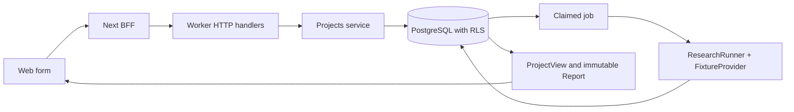

# M1 walkthrough: browser, PostgreSQL and code

Verified locally on 2026-10-29. This is synthetic demonstration data, not market research. No real provider or deployment was enabled. Application code and database schema were not changed for this walkthrough.

## Open in VS Code

The repository folder is C:\Users\Admin\Desktop\Github Work\KnowYourBusiness. The Explorer should show apps, packages, supabase, docker and docs. Use Ctrl+P to open the paths below. For a readable table reference, open docs/database/SCHEMA.md and press Ctrl+Shift+V for Markdown preview. Use Ctrl+P again to move from the reference to the actual SQL or TypeScript.

The PostgreSQL container holds the engine and binary database storage. The repository on Windows holds the application and migration code. Editing a Markdown field reference does not change the database. Schema changes require a new reviewed SQL migration; do not edit Docker volume files or rewrite applied migrations.

## 1. Inspect real table metadata

In VS Code choose Terminal -> New Terminal, with the repository root as the working folder:

```sh
npm run db:shell
```

Then enter these psql commands one at a time:

```text
\dt public.*
\d public.projects
\d public.profile_versions
\d public.research_runs
\d public.jobs
\d public.evidence_records
\d public.report_versions
\q
```

These commands use the PostgreSQL client already installed in Docker. No additional extension or host psql installation is needed. The existing inspector is read-only and receives no tenant-owned rows under RLS; an empty SELECT result is expected. Do not disable RLS or connect as postgres to make a viewer show customer data.

For the same structure in Docker Desktop: Containers -> next-signal-local -> postgres -> Exec, then `psql -U kyb_local_inspector -d next_signal_local`.

Key fields to read first:

| Table | Fields | Meaning |
| --- | --- | --- |
| projects | id, workspace_id, idea, stage, scenario | Original input and ownership; scenario selects a development fixture |
| profile_versions | id, project_id, version, status, content, confirmed_at | Immutable business profile versions and founder confirmation |
| consent_events | project_id, notice_version, processing_consent, marketing_opt_in | Service processing notice and separate optional marketing interest |
| research_runs | id, project_id, profile_id, status, plan, calls_used, max_calls | A run tied to the exact confirmed profile and bounded provider plan |
| jobs | id, run_id, status, attempts, lease_token, lease_until | Durable worker delivery, retry and lease fencing |
| run_events | run_id, from_status, to_status, created_at | Research state history |
| provider_calls | run_id, provider, status, cost_minor, currency | Fixture call accounting; not proof of a real API request |
| evidence_records | id, run_id, payload | Typed source/region/method/value/limitations |
| findings / finding_evidence_links | id or finding_id, evidence_id, relation, payload | Conclusion and its supporting/counter-evidence links |
| action_items | finding_id, run_id, payload | Experiments tied to a finding |
| report_versions | id, run_id, payload, created_at | Immutable report snapshot |

`id` identifies a row. `project_id` connects it to a project; `run_id` connects it to a research attempt. `workspace_id` participates in tenant isolation. Composite foreign keys prevent linking another workspace's rows. `uuid` is an identifier, `timestamptz` stores a timestamp, `jsonb` stores a structured object, and `NULL` means absent/unknown rather than zero. Foreign keys, indexes and forced RLS can be inspected with \d.

## 2. The retained demonstration project

Navigation update — 2026-11-02: open http://127.0.0.1:3000/validate, choose Alice, and open the project whose summary starts with `M1 walkthrough fixture:`. Reports now appear as summaries with View report links to private detail pages; Back to project restores the selected project. Historical walkthrough data/IDs below are unchanged. The earlier signed-in/expanded-page observation describes the 2026-10-29 session only. Sign in again if the one-hour session expires. The project remains until explicitly deleted; its list position can change when other projects are created.

Input:

```text
M1 walkthrough fixture: a booking reminder service for Australian independent tutors. Synthetic test idea only.
```

Corrected customer: `Australian independent tutors (walkthrough fixture)`.

Corrected problem: `Reduce missed tutoring appointments; an unvalidated founder statement.`

These statements describe a hypothetical product; no demand or willingness to pay has been validated. Processing consent was checked; marketing interest was left unchecked. Scenario was normal.

Actual identifiers:

| Record | ID |
| --- | --- |
| Project | cbf0471c-2dc4-4a0f-ba46-df62cb486ed0 |
| Initial profile, version 1 | 184f7559-779d-4857-9396-21b934e610d1 |
| Confirmed profile, version 2 | 8ec284ca-67bc-475b-8fa9-ffa1bb4c1102 |
| Research run | 103248c8-c242-4fe4-976e-081f4663a684 |
| Job | 3a4ae7ff-272d-49f9-86e6-3ff42e2f7cd5 |
| Evidence | ff572cac-385b-41b3-9d38-2b7f451d9152 |
| Report | 4bed9230-76d9-4b08-84c3-dc96f8573833 |

Actual row counts for this project: 2 profile versions, 1 consent event, 1 run, 1 job, 6 run events, 1 fixture provider-call record, 1 evidence record, 1 finding, 1 finding/evidence link, 3 actions and 1 report. The project has stage=idea. The first profile remains awaiting_confirmation, while the second profile is confirmed: confirmation creates a new version rather than modifying the original.

## 3. Follow the same data across layers

| Browser operation | HTTP request from web | PostgreSQL effect | Main code |
| --- | --- | --- | --- |
| Prepare fixture profile | POST /api/projects | Insert projects, initial profile_versions, consent_events and audit event | apps/web/app/ui.tsx create; packages/application/src/projects.ts Projects.create |
| Correct customer/problem and confirm | POST /api/projects/{id}/confirm | Insert profile version 2 with confirmed status; preserve version 1 | Projects.confirm; contracts Profile and ConfirmProfile |
| Run fixture snapshot | POST /api/projects/{id}/runs | Insert research_runs, queued jobs and initial run_events | Projects.start |
| Worker processes queued job | Internal claim function; no browser provider call | Claim lease; advance run; persist evidence/findings/links/actions/report in a checked transaction | packages/application/src/runner.ts ResearchRunner.processOne |
| Show progress/report | GET /api/projects/{id} through periodic polling | Read profiles, runs and report payload under tenant RLS | Projects.get; apps/web/app/report-view.tsx ReportView |
| Switch English/Chinese | Local UI preference | No research data rewrite or translation-provider call | apps/web/lib/i18n.ts; apps/web/app/language-switch.tsx |

Every web request passes through apps/web/lib/bridge.ts and apps/worker/src/server.ts. The worker resolves the fixture session to an actor; browser-supplied workspace IDs are not trusted. packages/adapters/src/postgres.ts binds that actor within a transaction using SET LOCAL ROLE kyb_app and a transaction-local identity. This is an explicit local test-identity model, not production JWT authentication.



Run events were observed as queued -> planning -> collecting -> analysing -> validating -> partial. The job is done with attempts=1. These statuses answer different questions: done means the queue delivery finished; partial means evidence coverage is incomplete. The report is synthetic=true and humanReviewed=false.

The confirmed profile ID equals research_runs.profile_id and report_versions.payload.profileId. The report's runId matches research_runs.id. Expanding the evidence in the browser shows the exact evidence ID listed above, linking the visible card to evidence_records.id.

The actual evidence object contains:

```json
{
  "id": "ff572cac-385b-41b3-9d38-2b7f451d9152",
  "provider": "fixture",
  "synthetic": true,
  "metric": "search_volume",
  "value": null,
  "confidence": "insufficient",
  "sourceRef": "fixture:search-volume:unavailable"
}
```

This is an excerpt, not the complete Evidence contract. `null` renders as insufficient data, not zero searches. The associated finding says customer demand/willingness to pay remain unknown. Three experiments are fixed templates, not personalized advice. provider_calls has provider=fixture, status=completed, cost_minor=0, currency=AUD; the run plan has externalCalls=0 and calls_used=1/max_calls=2. This accounting row is not a real ABS/DataForSEO/AnswerThePublic call.

## 4. Find the actual code

Use Ctrl+P in VS Code:

| Path | Look for |
| --- | --- |
| supabase/migrations/202610270001_m1.sql | CREATE TABLE, foreign keys, RLS policies and immutability triggers |
| packages/contracts/src/index.ts | Profile, Evidence, Report; JSON keys and validation |
| apps/web/app/ui.tsx | create, confirmation form, run button and project polling |
| apps/web/lib/bridge.ts | Same-origin BFF, private session cookie and route allowlist |
| apps/worker/src/server.ts | HTTP endpoint dispatch and session-derived actor |
| packages/application/src/projects.ts | create / confirm / start / get / delete |
| packages/application/src/runner.ts | processOne, transition and report persistence |
| packages/adapters/src/fixture-provider.ts | Synthetic evidence source |
| packages/adapters/src/postgres.ts | SET LOCAL ROLE and transaction-local user binding |
| apps/web/app/report-view.tsx | Rendering evidence and its visible ID |

Profile content.customer/content.problem are JSON keys inside profile_versions.content, not individual SQL columns. Report findings/actions/evidence are validated JSON inside report_versions.payload and also stored in relational tables for traceability.

## Actual verification and files

Docker Linux Engine 29.9.2 was checked before starting npm run dev. /api/health returned mode=local-fixture and database=postgresql. The browser created/confirmed/ran the demonstration and displayed the report. Real psql inspected projects/profile_versions/report_versions metadata. A local read-only inspection used the existing native runtime adapter as Alice, checked counts/IDs and equality between Projects.get and the stored report payload, and confirmed Bob sees zero matching project rows. No role grants, admin data queries, schema changes or RLS changes were made.

For repeat inspection on this workstation only, the ignored `.local/inspect-m1-walkthrough.ts` performs the same read-only assertions; run `npx tsx .local/inspect-m1-walkthrough.ts` from the root. It writes `.local/m1-walkthrough.json`, limited to this exact synthetic project. It contains no credentials. These local inspection artifacts are intentionally not committed and are not general-purpose production administration tools. They stop with an error if the demonstration project is missing or its expected versions/runs have changed.

The only repository documentation added for this task is this file. The synthetic project was retained for owner inspection. No dependencies were installed; full regression suites, lint/typecheck/build and remote CI were not rerun for this documentation/data walkthrough. Previous cutover verification remains a separate dated record. Current fixture completion proves the local software path, not market validity or production/provider/legal readiness.
